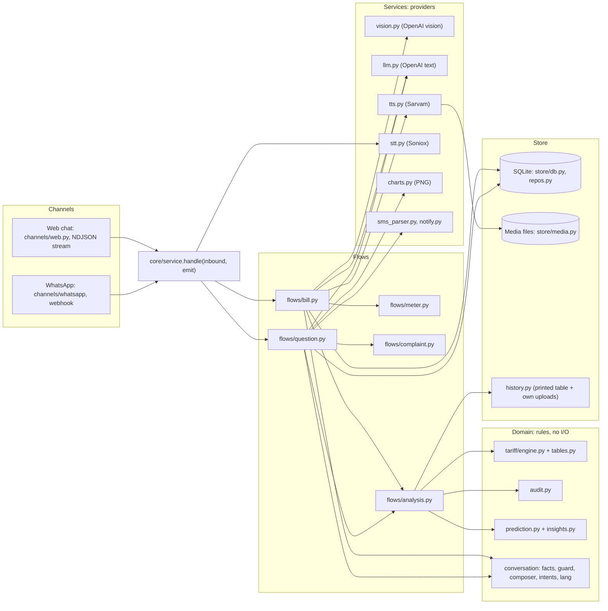
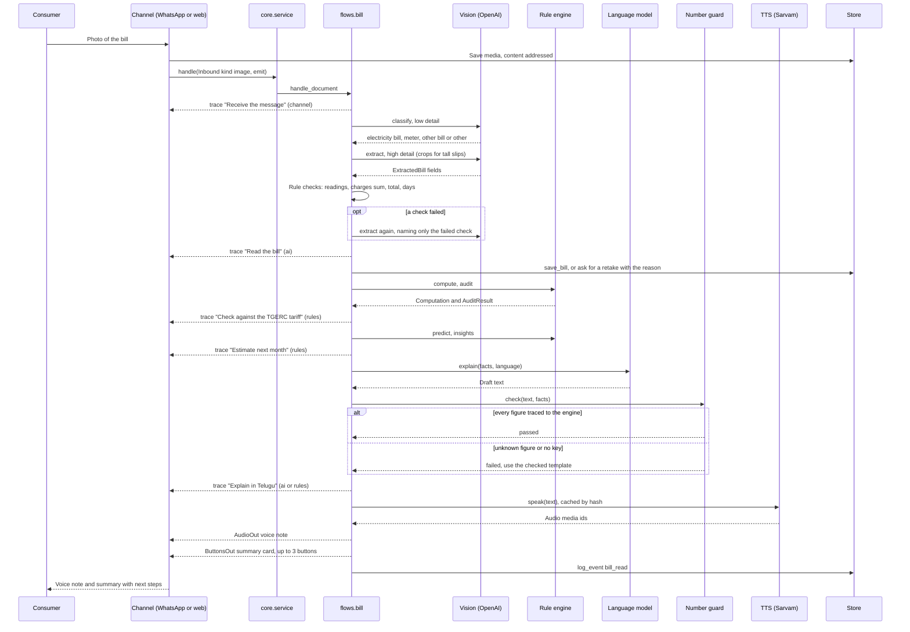

# Bill Mitra Architecture

## 1. Overview

Bill Mitra is a Telugu-first electricity bill assistant for households in Telangana, built to run on WhatsApp. A consumer sends a photo of the bill (or a PDF, an SMS, a typed unit count or a voice note) and gets back a voice note and a short text that explain the bill, check it against the TGERC tariff and estimate next month. The web app in this repo has sign in with three roles: consumers get a bill dashboard and a WhatsApp preview chat, officers get a Department console and a complaints inbox, and admins manage accounts. A tariff explorer is open to all. The backend has one channel-agnostic conversation engine, `core/service.handle(inbound, emit)`, and thin adapters for the web (NDJSON stream) and the WhatsApp Cloud API (webhook). The main rule is simple: rules calculate, AI explains. The tariff engine computes every rupee, the language model only reads the photo and words the answer, and a number guard rejects any AI text that carries a figure the engine did not produce.

## 2. Diagrams

The pitch diagram is at `frontend/public/architecture.png` and is shown on the How it works page. It also shows pilot-year items such as IVR and smart meter feeds, which are not in this build.

### Components

### Consumer sends a bill photo

## 3. Backend modules

| Folder | What it does | Key files |
|---|---|---|
| `app/main.py` | FastAPI app, CORS, security headers, routers, serves the built web app, 404 for unknown `/api` paths | `main.py` |
| `app/core` | Channel-neutral engine, message types shaped on the Cloud API, reasoning trace, sessions and passwords, rate limits, upload type checks | `service.py`, `messages.py`, `trace.py`, `security.py`, `ratelimit.py`, `uploads.py` |
| `app/flows` | One file per conversation path; holds the per-turn state | `turn.py`, `bill.py`, `question.py`, `meter.py`, `complaint.py`, `analysis.py`, `report.py` |
| `app/domain/tariff` | Versioned TGERC LT-I domestic tables and the calculator | `tables.py`, `engine.py` |
| `app/domain` | Bill model, rule checks on a reading, line-by-line audit, next-bill estimate, advice | `bill.py`, `capture.py`, `audit.py`, `prediction.py`, `insights.py` |
| `app/domain/conversation` | Facts the reply may use, number guard, templates, intent rules, language packs | `facts.py`, `guard.py`, `composer.py`, `intents.py`, `lang/{te,en,hi,ur}.py` |
| `app/services` | Provider calls and helpers: vision, text model, TTS, STT, chart PNG, SMS parser, complaint reply delivery | `vision.py`, `llm.py`, `openai_client.py`, `tts.py`, `stt.py`, `charts.py`, `sms_parser.py`, `notify.py` |
| `app/store` | SQLite schema and repositories, media files, history from the bill and own uploads, console queries, accounts, complaints | `db.py`, `repos.py`, `media.py`, `history.py`, `console.py`, `accounts.py`, `complaints.py` |
| `app/channels` | Web NDJSON adapter and WhatsApp webhook, mapper and Graph client | `web.py`, `whatsapp/router.py`, `whatsapp/mapper.py`, `whatsapp/client.py` |
| `app/api` | Auth, admin, bill dashboard, complaints, catalog (health, tariffs, media) and the console | `auth.py`, `admin.py`, `bills.py`, `complaints.py`, `catalog.py`, `console.py`, `deps.py` |

## 4. The turn lifecycle

1. A channel builds an `Inbound` (channel, user_id, kind, text, reply_id, media_id, mime_type) and an `emit` function, then calls `service.handle`.
2. `handle` loads the user state from SQLite (language, current bill, what we are waiting for) and wraps `emit` in a `Tracer`.
3. `_dispatch` routes by kind: image or document to `flows/bill.py`, audio to speech-to-text then the text path, button_reply to `question.handle_button`, text to `question.handle_text`. On WhatsApp, the script of a typed message (Telugu, Devanagari, Arabic) switches the reply language.
4. Each piece of work runs inside `tracer.step(label, mode)`. A step emits a `trace` event when it starts (status running) and again when it ends (done, failed or skipped) with a detail line and the time in ms. The mode says who did the work: `ai`, `rules` or `channel`. A step can change its own mode, for example "Explain" turns to `rules` when the template is used.
5. Replies go out through `tracer.message(...)` as `message` events carrying one `Outbound`. A voice question also emits a `transcript` event with what was heard.
6. Any exception is logged and replaced with a short error text in the user's language. The user state is saved in `finally`.
7. The web channel streams each event as one JSON line (`application/x-ndjson`) and ends with `{"kind": "done"}`. So the web page sees four kinds: `trace`, `message`, `transcript`, `done`. The `Event` model also allows `state`, which is reserved and not emitted today. The WhatsApp channel ignores everything except `message` events and sends those through the Graph API.

## 5. Rule engine

**Tariff versions.** `tables.py` holds four versions, `TGERC-RST-2023-24` to `TGERC-RST-2026-27`, each with its effective dates. The domestic rates are the same in all four. The FY 2026-27 version adds the true-up rule. `version_for(bill_month)` picks the version in force for the bill month, so an old bill is checked against the old order. Months before the first version use the first one.

**Groups and slabs.** The group is chosen by total monthly units, and slabs are telescopic inside the group. Slab limits are pro-rated by billing days divided by the days in the month the period started. That rule is not in the schedule; we inferred it from two real TGSPDCL bills, which the engine reproduces to the paisa.

| Group | Applies up to | Slabs (Rs per unit) |
|---|---|---|
| LT-I(A) | 100 units | 0 to 50 at 1.95, 51 to 100 at 3.10 |
| LT-I(B) | 200 units | 0 to 100 at 3.40, 101 to 200 at 4.80 |
| LT-I(C) | no limit | 0 to 200 at 5.10, 201 to 300 at 7.70, 301 to 400 at 9.00, 401 to 800 at 9.50, above 800 at 10.00 |

**Charges.** `compute(units, bill_month, load_kw, gruha_jyothi_eligible)` returns energy (sum of slab lines), fixed charge (Rs 10 per kW, minimum 1 kW), customer charge by band from the TGERC schedule (Rs 40, 70, 90, 100, 120, 140, 160 for up to 50, 100, 200, 300, 400, 800 and above), electricity duty (Rs 0.06 per unit) and FSA (per-month rate table, empty today so FSA is 0). Gross is the sum. FSA and billing-day pro-rating are marked `verify`, plus the FY 2024-25 customer charges. The DISCOM billing team must confirm them before the pilot. Units for net metering are import minus export.

**Gruha Jyothi.** If the household is eligible and units are 200 or less, the subsidy equals the gross and the net bill is 0. At 201 units the full bill applies, and the audit adds the note `gruha_jyothi_lost`. Eligibility comes only from what the bill prints.

**True-up.** From 1 Nov 2026 the order allows a per-unit recovery: Rs 0.30 in the first month, Rs 0.50 after. The engine does not add true-up to the net. The audit lists a printed true-up line as `not_checkable` with an explanation, and flags it if the line appears before the order starts.

**Audit.** `audit.py` compares each printed charge (energy, fixed, customer, duty, FSA) with the engine, with a tolerance of Rs 1.

| Status | When |
|---|---|
| `verified` | All lines match within Rs 1, or only a total was printed and it matches |
| `mismatch` | At least one line is over or under by more than Rs 1; overcharge and undercharge are summed |
| `partial` | A line is missing, or only a total was printed and it differs (a total alone can confirm a bill, never accuse one) |
| `not_checkable` | Not a domestic LT-I bill |
| `calculated` | No line items and no amount, for example typed units; the engine total is shown |

Notes also cover arrears, net metering and Gruha Jyothi applied or lost.

**Prediction.** `prediction.py` estimates next month. History is the usage table printed on the bill plus the account's own earlier uploads for the same service number (`store/history.py`). With at least 6 months of history and the same month last year, it uses last year's units times the recent trend (last 3 months against the same 3 months a year before, clamped to 0.7 to 1.4). Otherwise it scales this month by a Telangana seasonal factor table (summer peak, monsoon dip). The range is plus or minus 8 percent, the amount comes from `compute`, and `crosses` flags 100 or 200 if the range goes over it.

**Insights.** `insights.py` builds the what-if curve (amount for every unit count up to at least 400), the cliffs at 100 and 200 (the jump from one unit more), a saving tip only when the cut needed to get under a threshold is at most a fifth of use (in rupees and in AC minutes per day at 1.5 kWh per hour and geyser minutes at 2 kWh per hour), and the change against last month.

## 6. AI usage and guardrails

| Use | Where | Guardrail and fallback |
|---|---|---|
| Read the bill or meter photo | `services/vision.py`, model `gpt-4.1` | A low-detail first look classifies the image and stops non-bills. The high-detail read returns a fixed JSON field list, validated by the `ExtractedBill` Pydantic model. `domain/capture.py` runs the rule checks (readings, charges sum, total, billing days). On a failed check the bill is read once more with only the name of the check; if it still fails, the consumer is asked to retake with the reason. No key or provider error: ask the consumer to type units |
| Word the explanation | `services/llm.py`, model `gpt-4.1-mini` | Gets only the `Facts` object. Output goes through the number guard. No key, error or failed guard: the template from `composer.py` |
| Classify a question | `services/llm.py` | Called only when keyword rules return `off_topic`. The answer must be one of the fixed `INTENTS`, else ignored. No key: fixed off-topic reply |
| Telugu voice | `services/tts.py`, Sarvam `bulbul:v3`, speaker `kavya` | Cached on disk by sha256 of model, speaker, pace, language and text, so a cached note plays even without a key. Chunks of up to 1200 characters. No key or Urdu (no voice): text only |
| Listen to a voice note | `services/stt.py`, Soniox `stt-async-v5` | Language hints te, hi, en, ur; the detected language switches the reply. No key or failure: ask the consumer to type. Uploaded file and transcription are deleted at Soniox after use |

**Vision prompt fields.** document_type (bill, meter, other), is_electricity_bill, quality and quality_issue, meter_reading, discom, service_number, section, category, is_domestic, bill_month, bill_date, due_date, previous and present readings, units, export_units, load_kw, line_items (code, label, amount, with codes energy, fixed, customer, duty, fsa, true_up, surcharge, adjustment, other), bill_amount, arrears, total_payable, gruha_jyothi_household, subsidy_amount, confidence. The prompt says to read numbers as printed and never to return name, address or phone. PDFs of up to 3 pages are rendered with pypdfium2 and the page that is a bill is read. HEIC photos are accepted. Photos are EXIF-rotated. A page taller than twice its width (a thermal spot-billing slip) is read as up to 4 overlapping crops, because the API shrinks images to about 768 px on the short side. Rate limits and server errors are retried with back-off in `openai_client.py`.

**Explanation prompt.** 5 to 8 short sentences in the consumer's language, only numbers from the facts, a fixed order (what they pay and why, Gruha Jyothi, whether the bill is right, anything unusual, one saving tip, next month).

**Number guard.** `guard.py` first maps Telugu, Devanagari and Arabic-Indic (Urdu) digits to Western digits, then finds every number in the text. Each one must match, within 0.011, a value from the facts (raw, rounded and whole), a number inside a fact string, or a small always-allowed set (0 to 10, 12, 24, 30, 50, 100, 101, 200, 201, 300, 400, 800, 1912, years 2022 to 2027). One unmatched number fails the whole text, and the trace step names it.

**Intent set.** `intents.py` has 19 fixed intents (why_high, next_bill, save, complain, explain_fsa, explain_fixed, explain_customer, explain_duty, explain_true_up, gruha_jyothi, due, what_if, greeting, thanks, power_cut, new_connection, help, stop, off_topic). Keyword rules in English, Telugu (script and romanised), Hindi and Urdu run first. Every answer is a template filled with engine values. There is no free-form chat.

## 7. WhatsApp mapping

Limits are enforced in `core/messages.py` by Pydantic, so a reply that breaks a Cloud API limit fails in our code, not at Meta.

| Outbound | Cloud API payload | Limits |
|---|---|---|
| `TextOut` | `type: text`, `preview_url: false` | body up to 4096 characters |
| `ImageOut` | upload, then `type: image` with `id` and caption | caption up to 1024 |
| `AudioOut` | upload each chunk, one `type: audio` message per chunk | converted to OGG/Opus so it shows as a voice note |
| `ButtonsOut` | `type: interactive`, `interactive.type: button`, reply buttons | 1 to 3 buttons, title up to 20, body up to 1024 |
| `ListOut` | `type: interactive`, `interactive.type: list`, one section | 1 to 10 rows, row title up to 24, description up to 72, button label up to 20, unique row ids. Defined for menus; current flows use buttons |

**Inbound mapping** (`mapper.parse_webhook`): `text` to text, `image`, `document` and `audio` to the same kinds with the WhatsApp media id, `interactive` button_reply or list_reply to `button_reply` with the id, template `button` to `button_reply` with the payload. Other types are ignored. The sender number becomes `wa:` plus the first 20 hex characters of its sha256; the raw number is used only to address the reply.

**Webhook.** `GET /api/whatsapp/webhook` answers Meta's check: if `hub.mode` is `subscribe` and `hub.verify_token` matches `WHATSAPP_VERIFY_TOKEN` (constant-time compare) it returns `hub.challenge`, else 403. `POST` returns 503 until the channel is configured, then checks `X-Hub-Signature-256` as an HMAC SHA-256 of the raw body with `WHATSAPP_APP_SECRET`. A bad signature gets 401. If the app secret is empty the check is skipped, so it must be set for the pilot. Messages are processed as background tasks so Meta gets a quick 200.

**Media.** `client.download` gets the media URL from the Graph API, downloads the bytes with the bearer token and saves them in our media store. `client.upload` posts our file to `/{phone_number_id}/media` and returns the WhatsApp id. Audio is converted with `ffmpeg -c:a libopus -b:a 32k -f ogg`. Without ffmpeg it is sent as MP3 (plays as a file, not a voice note). Each inbound message is marked read first.

**Switch on.** Set `WHATSAPP_TOKEN`, `WHATSAPP_PHONE_NUMBER_ID` and `WHATSAPP_VERIFY_TOKEN` (plus `WHATSAPP_APP_SECRET`), point the Meta webhook at `/api/whatsapp/webhook`, and `/api/health` reports `whatsapp: connected`.

## 8. Data model

SQLite at `var/billmitra.db` in WAL mode. All SQL lives in `store/`, so a move to Postgres replaces that folder only.

| Table | Holds | Notes |
|---|---|---|
| `users` | user_id, channel, language, current_bill_id, awaiting | user_id is `acct:<account id>` on the web or the `wa:` sha256 pseudonym |
| `bills` | id, user_id, service_number, extraction (JSON), media_id, bill_month, units, total, audit status | full service number kept only with the bill itself |
| `complaints` | ticket, user_id, bill_id, service_masked, bill_month, discom, issue, amount, status, language | ticket `BM-yymmdd-nnnnn`; status Open, In progress, Resolved or Rejected. Holds the WhatsApp number only to send replies |
| `complaint_messages` | ticket, author kind, author, body, delivery, delivery note | the thread; delivery records sent, template or failed with the reason |
| `events` | ts, channel, type, language, intent, audit_status, units, amount, discom, section | no personal data; feeds the console |
| `accounts` | id, role, login, name, password_hash (scrypt), discom, active, failed_logins, locked_until | roles admin, officer, consumer |
| `sessions` | token_hash, account_id, expires_at | only the hash of the cookie token is stored |
| `audit_log` | ts, actor_id, action, target, detail | admin and complaint actions |
| `whatsapp_seen` | message_id | dedupe, so Meta's retries are handled once |

**Media store.** Files in `var/media`, named by the first 24 hex characters of their sha256 plus an extension. A media id must match `^[a-f0-9]{24}\.[a-z0-9]{2,5}$`, so a path such as `../../etc/passwd` returns 404. The TTS cache index is `var/tts_index.json`.

**What is kept.** The bill fields we read, the bill image, the voice notes, complaints with their threads, accounts and counts for the console. A retention job removes data older than `RETENTION_DAYS` (180 by default).

**What is never stored.** Consumer name, address and phone number from the bill (not extracted). The raw WhatsApp number is stored only on a complaint, to send the officer's reply; it is never returned by the API or logged. The console only sees masked service numbers (bullets plus the last 4 digits).

**STOP and account deletion.** Typing STOP (or ఆపండి, रोको, بند کرو), or deleting the account in the web app, erases the user's bills, chat and any media no complaint refers to. Complaint rows and anonymous events stay for the record.

## 9. API reference

The full contract for accounts, admin and complaints, with bodies and roles, is in [docs/api-contract.md](docs/api-contract.md). Short list:

| Path | Who | Purpose |
|---|---|---|
| `/api/auth/*` | public, then signed in | login, register, logout, me, change password |
| `/api/admin/accounts`, `/api/admin/audit` | admin | staff accounts and the audit log |
| `/api/bills`, `/api/bills/{id}` | signed in, owner | upload a bill and get the report; past bills |
| `/api/bills/{id}/complaint` | bill owner | raise a complaint from the dashboard |
| `/api/me/complaints` | signed in | own complaints, thread and reply |
| `/api/console/summary`, `/api/console/complaints` | admin, officer | console metrics, inbox, reply, status, CSV export |
| `/api/web/upload`, `/api/web/messages`, `/api/web/reset` | signed in | the web chat channel (NDJSON stream) |
| `/api/media/{id}` | signed in | a stored photo, voice note or chart; id validated |
| `/api/health`, `/api/tariffs`, `/api/tariffs/calculate` | public | provider modes and the tariff engine |
| `/api/whatsapp/webhook` | Meta | verification and inbound messages |

## 10. Frontend

React 19, TypeScript, MUI 9, TanStack Query 5, React Router 7, built with Vite.

**Routes.** `/login` and `/register` are public. A consumer lands on the Dashboard (upload and past bills, `/bills/:id` for one report), with the Assistant (phone frame and trace panel) and My complaints. An officer gets the Console and the complaints inbox. An admin also gets accounts and the audit log. `/how-it-works` holds the principles, the tariff table, the explorer and the WhatsApp readiness list. Pages check the role, and the server checks it again on every call.

**Feature slices.** `src/features/{auth,dashboard,assistant,complaints,console,admin,explorer}`, each with `api`, `components`, `hooks`, `model` and `routes` as needed. Shared code is in `src/shared` (HTTP and NDJSON reader, query keys, URL state, formatting, mode status, stat tile, loading and error states). `src/app` holds the router, query client and shell.

**State.** The chat uses `useConversation`, a `useReducer` with actions user, trace, bot, transcript, done, failed and reset. It reads the stream line by line and dispatches as events arrive. The session is an httpOnly cookie the page never reads; a 401 sends the user to `/login`. Server data (health, bills, tariffs, the debounced calculator, console summary, complaints and accounts) goes through TanStack Query with typed keys. Console queries refresh every 15 seconds.

**Pagination.** Paging is server side. Page, size, filters and sort live in the URL, so a filtered view can be shared as a link. Changing a filter resets the page, and `keepPreviousData` avoids flicker.

**Theme.** `src/theme` sets the AI Planet navy (`#1B2A4A`) and green (`#12A853`), chat colours close to the familiar messaging look without WhatsApp marks, one colour per trace mode (ai, rules, channel), and a Noto Sans stack covering Telugu, Devanagari and Arabic script.

## 11. Configuration and modes

Settings come from the environment or `.env` (repo root or `backend/`). Every provider is optional.

| Setting | Effect when missing |
|---|---|
| `OPENAI_API_KEY` | Bill reading is off and the consumer types the units; explanations use templates, intents use keyword rules only. Nothing is faked |
| `OPENAI_BASE_URL`, `OPENAI_VISION_MODEL`, `OPENAI_TEXT_MODEL` | Defaults: OpenAI, `gpt-4.1`, `gpt-4.1-mini`. We run on Azure OpenAI through the base URL |
| `SARVAM_API_KEY` | No new voice notes; cached ones still play; replies go as text |
| `SARVAM_MODEL`, `SARVAM_SPEAKER`, `SARVAM_PACE` | Defaults `bulbul:v3`, `kavya`, 0.95 |
| `SONIOX_API_KEY` | Voice notes are not transcribed; the consumer is asked to type |
| `WHATSAPP_TOKEN`, `WHATSAPP_PHONE_NUMBER_ID`, `WHATSAPP_VERIFY_TOKEN` | WhatsApp webhook returns 503; health says "ready, not connected" |
| `WHATSAPP_APP_SECRET` | Signature check skipped (set it before going live) |
| `WHATSAPP_GRAPH_URL` | Default Graph API v21.0 |
| `WHATSAPP_COMPLAINT_TEMPLATE` | Officer replies outside the 24 hour window are recorded as failed with the reason |
| `DATA_DIR`, `FRONTEND_DIST` | Defaults `backend/var`, `frontend/dist`; without a build only the API is served |
| `CORS_ORIGINS` | Must include the Vite dev origin `http://localhost:5173` in dev |
| `BOOTSTRAP_ADMIN_EMAIL`, `BOOTSTRAP_ADMIN_PASSWORD` | No admin is created; set both for the first start |
| `SESSION_HOURS`, `COOKIE_SECURE` | Defaults 12 hours and off; turn `COOKIE_SECURE` on behind HTTPS (also sends HSTS) |
| `PRIVACY_NOTICE_VERSION`, `PRIVACY_CONTACT` | Version and contact shown in the privacy notice |
| `RETENTION_DAYS` | Default 180 |
| `REQUEST_TIMEOUT_S`, `MAX_UPLOAD_MB` | Defaults 45 seconds and 12 MB |

Run with `./run.sh` (builds the web app once, serves everything on port 8000) or `./run.sh dev` (API with reload on 8000, Vite on 5173).

## 12. Production path for the pilot (next, not built)

Everything in this section is planned work. None of it is in this build.

- **Hosting.** Run in an Indian cloud region or on the Telangana state cloud so data stays in India.
- **Database.** Postgres in place of SQLite, by replacing `store/`, and a shared store for rate limits, so the API can run as more than one process.
- **Media.** Object storage with server-side encryption and lifecycle rules in place of the local folder.
- **Queue.** Put provider calls (vision, TTS, STT, WhatsApp sends) behind a queue with retries, so webhook bursts on bill day do not block and a slow provider does not drop a turn.
- **Observability.** Structured logs without personal data, metrics per trace step and provider, alerts on guard failures and provider error rates.
- **Security.** VAPT before launch, secrets in a vault, enforced webhook signature, media access checked per owner, SMS OTP at sign up, an HTTPS proxy and backups.
- **DISCOM billing API.** Add the TGSPDCL or TGNPDCL billing API to `history.py` for 12-month history and Gruha Jyothi eligibility, with the consumer's agreement, and confirm the `verify` tariff figures with the billing team.
- **1912 grievance API.** Register `BM-` tickets on the 1912 system and sync status back. Add assignment to a named officer and SLA escalation.

## 13. Testing

`cd backend && pytest` collects 133 tests today. There are no made-up bills. The suite runs on the two real TGSPDCL bills in `tests/real_bills`, with identifiers replaced (`tests/real.py`). Where a test needs a case no real bill shows, it changes one printed figure and says so.

- `test_tariff.py`: slabs and groups at the boundaries, billing-day pro-rating, both real bills reproduced to the paisa, customer charge bands, Gruha Jyothi up to 200 and lost at 201, each tariff version picked by bill month, true-up rates.
- `test_capture.py` and `test_vision.py`: the rule checks on a reading, the re-read that names only the failed check, crops for tall slips, PDF page choice, a non-bill never read in detail, HEIC photos.
- `test_conversation.py`: end-to-end turns on the real bills: verified with no prompt in between, overcharge and complaint, a misread never trusted, unreadable photo then typed units, reading off without a key, meter projection, an earlier upload becoming history, SMS bill, what-if, STOP in every language, every scenario in all four languages, and WhatsApp limits on every reply.
- `test_auth.py`, `test_security.py`, `test_bills_api.py`, `test_complaints.py`: sessions, roles, lockout, rate limits, Origin check, headers, the dashboard API, complaint threads, replies and statuses.
- `test_channels.py` and `test_openai_client.py`: webhook parsing and signature, user key never holding the number, the number guard, retries with back-off.

Frontend checks: `npm run typecheck` (strict TypeScript for app and Node config) and `npm run lint` (ESLint with zero warnings allowed). `npm run build` runs the typecheck first.

---

Maintained by Meraj Akhtar, AI Planet.
