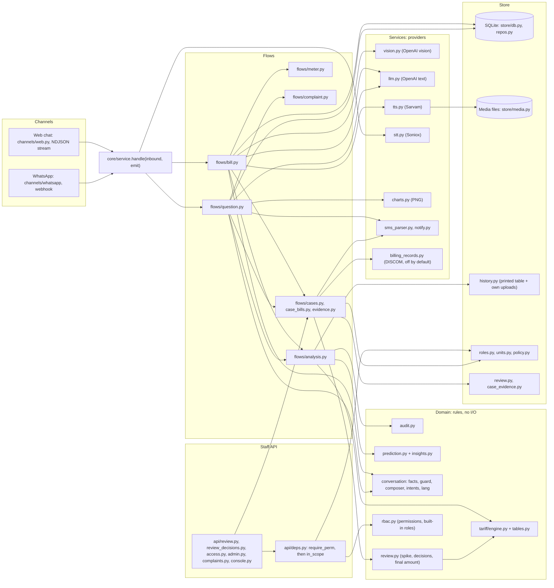
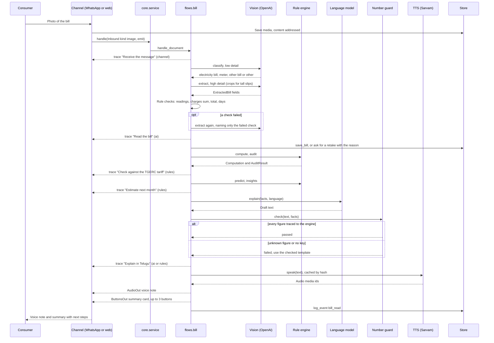
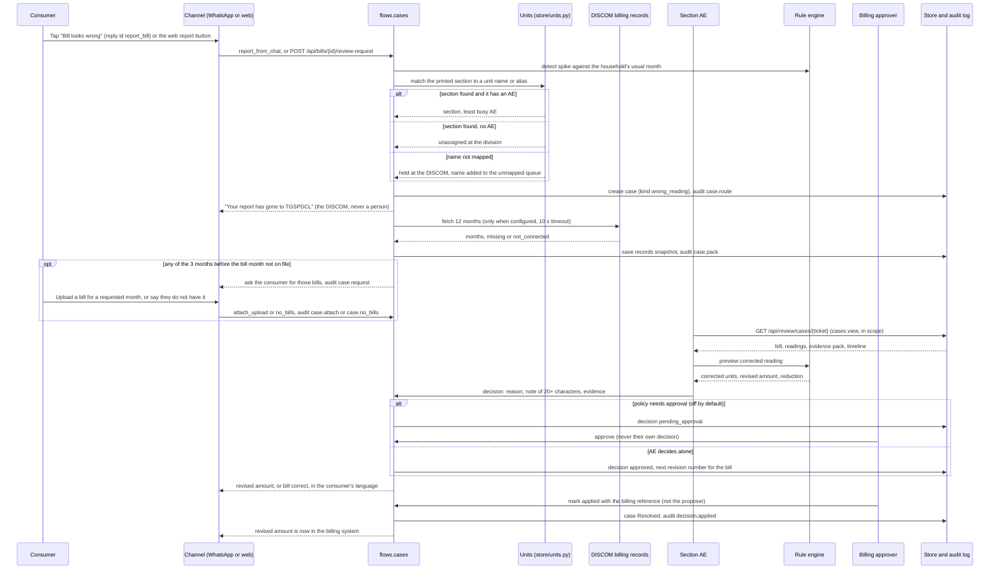

# Bill Mitra Architecture

## 1. Overview

Bill Mitra is a Telugu-first electricity bill assistant for households in Telangana, built to run on WhatsApp. A consumer sends a photo of the bill (or a PDF, an SMS, a typed unit count or a voice note) and gets back a voice note and a short text that explain the bill, check it against the TGERC tariff and estimate next month. If the bill looks wrong, the consumer taps "Bill looks wrong" in the chat (or "Report a problem with this bill" on the web) and the bill goes to the section office for review, with the evidence already gathered. An approved revision becomes the consumer's bill for that month.

The web app has sign in with role-based access. Consumers get a bill dashboard and a WhatsApp preview chat. DISCOM staff get the console, the complaints inbox and the review queue, each limited to the units in their scope. A super admin manages roles, units, review policy and accounts. Access is decided by permissions, never by role names: there are six built-in staff roles plus the consumer role, and a super admin can create custom roles.

The backend has one channel-agnostic conversation engine, `core/service.handle(inbound, emit)`, and thin adapters for the web (NDJSON stream) and the WhatsApp Cloud API (webhook). The main rule is simple: rules calculate, AI explains. The tariff engine computes every rupee, including a revised amount after review. The language model only reads the photo and words the answer, and a number guard rejects any AI text that carries a figure the engine did not produce.

## 2. Diagrams

The How it works page (`frontend/src/features/explorer`) has an interactive system map with journeys you can play step by step. Everyone sees "A consumer sends a bill". Staff also see "An officer resolves a complaint", "A wrong bill is reviewed" and "A super admin changes a role". Boxes are tagged built, planned or external, so the map also shows pilot items that are not in this build. The older pitch image is still at `frontend/public/architecture.png` but the page no longer uses it.

### Components

### Consumer sends a bill photo

### Consumer reports a wrong bill

The full rules for this flow are in [docs/review-contract.md](docs/review-contract.md). This is the default policy, where the AE decides alone.

## 3. Backend modules

| Folder | What it does | Key files |
|---|---|---|
| `app/main.py` | FastAPI app, CORS, security headers, routers, serves the built web app, 404 for unknown `/api` paths | `main.py` |
| `app/core` | Channel-neutral engine, message types shaped on the Cloud API, reasoning trace, sessions and passwords, rate limits, upload type checks | `service.py`, `messages.py`, `trace.py`, `security.py`, `ratelimit.py`, `uploads.py` |
| `app/flows` | One file per conversation path; holds the per-turn state. Bill review: opening and routing a case, asking for earlier bills, the evidence pack and timeline | `turn.py`, `bill.py`, `question.py`, `meter.py`, `complaint.py`, `analysis.py`, `report.py`, `cases.py`, `case_bills.py`, `evidence.py` |
| `app/domain/tariff` | Versioned TGERC LT-I domestic tables and the calculator | `tables.py`, `engine.py` |
| `app/domain` | Bill model, rule checks on a reading, line-by-line audit, next-bill estimate, advice, pricing at any unit count, review rules (spike, decisions, final amount), the permission catalogue and built-in roles | `bill.py`, `capture.py`, `audit.py`, `prediction.py`, `insights.py`, `pricing.py`, `review.py`, `rbac.py`, `complaint_reply.py` |
| `app/domain/conversation` | Facts the reply may use, number guard, templates, intent rules, language packs | `facts.py`, `guard.py`, `composer.py`, `intents.py`, `lang/{te,en,hi,ur}.py` |
| `app/services` | Provider calls and helpers: vision, text model, TTS, STT, chart PNG, SMS parser, complaint reply delivery, DISCOM billing records | `vision.py`, `llm.py`, `openai_client.py`, `tts.py`, `stt.py`, `charts.py`, `sms_parser.py`, `notify.py`, `billing_records.py` |
| `app/store` | SQLite schema and repositories, media files, history from the bill and own uploads, console queries, accounts and sessions, complaints, roles, the unit tree and scopes, review policy, cases and decisions, case evidence | `db.py`, `repos.py`, `media.py`, `history.py`, `console.py`, `accounts.py`, `complaints.py`, `roles.py`, `units.py`, `policy.py`, `review.py`, `case_evidence.py` |
| `app/channels` | Web NDJSON adapter and WhatsApp webhook, mapper and Graph client | `web.py`, `whatsapp/router.py`, `whatsapp/mapper.py`, `whatsapp/client.py` |
| `app/api` | Auth, staff accounts, roles, units and policy, bill dashboard and review requests, complaints, bill review cases and decisions, catalog (health, tariffs, media), console, privacy. `deps.py` holds `require_perm` and `in_scope` | `auth.py`, `admin.py`, `access.py`, `bills.py`, `complaints.py`, `complaint_actions.py`, `review.py`, `review_decisions.py`, `catalog.py`, `console.py`, `privacy.py`, `deps.py` |

## 4. The turn lifecycle

1. A channel builds an `Inbound` (channel, user_id, kind, text, reply_id, media_id, mime_type) and an `emit` function, then calls `service.handle`.
2. `handle` loads the user state from SQLite (language, current bill, what we are waiting for) and wraps `emit` in a `Tracer`.
3. `_dispatch` routes by kind: image or document to `flows/bill.py`, audio to speech-to-text then the text path, button_reply to `question.handle_button`, text to `question.handle_text`. On WhatsApp, the script of a typed message (Telugu, Devanagari, Arabic) switches the reply language.
4. Each piece of work runs inside `tracer.step(label, mode)`. A step emits a `trace` event when it starts (status running) and again when it ends (done, failed or skipped) with a detail line and the time in ms. The mode says who did the work: `ai`, `rules` or `channel`. A step can change its own mode, for example "Explain" turns to `rules` when the template is used.
5. Replies go out through `tracer.message(...)` as `message` events carrying one `Outbound`. A voice question also emits a `transcript` event with what was heard.
6. Any exception is logged and replaced with a short error text in the user's language. The user state is saved in `finally`.
7. The web channel streams each event as one JSON line (`application/x-ndjson`) and ends with `{"kind": "done"}`. So the web page sees four kinds: `trace`, `message`, `transcript`, `done`. The `Event` model also allows `state`, which is reserved and not emitted today. The WhatsApp channel ignores everything except `message` events and sends those through the Graph API.

## 5. Rule engine

**Tariff versions.** `tables.py` holds four versions, `TGERC-RST-2023-24` to `TGERC-RST-2026-27`, each with its effective dates. The domestic rates are the same in all four. The FY 2026-27 version adds the true-up rule. `version_for(bill_month)` picks the version in force for the bill month, so an old bill is checked against the old order. Months before the first version use the first one.

**Groups and slabs.** The group is chosen by total monthly units, and slabs are telescopic inside the group. Slab limits are pro-rated by billing days divided by the days in the month the period started. That rule is not in the schedule; we inferred it from two real TGSPDCL bills, which the engine reproduces to the paisa.

| Group | Applies up to | Slabs (Rs per unit) |
|---|---|---|
| LT-I(A) | 100 units | 0 to 50 at 1.95, 51 to 100 at 3.10 |
| LT-I(B) | 200 units | 0 to 100 at 3.40, 101 to 200 at 4.80 |
| LT-I(C) | no limit | 0 to 200 at 5.10, 201 to 300 at 7.70, 301 to 400 at 9.00, 401 to 800 at 9.50, above 800 at 10.00 |

**Charges.** `compute(units, bill_month, load_kw, gruha_jyothi_eligible)` returns energy (sum of slab lines), fixed charge (Rs 10 per kW, minimum 1 kW), customer charge by band from the TGERC schedule (Rs 40, 70, 90, 100, 120, 140, 160 for up to 50, 100, 200, 300, 400, 800 and above), electricity duty (Rs 0.06 per unit) and FSA (per-month rate table, empty today so FSA is 0). Gross is the sum. FSA and billing-day pro-rating are marked `verify`, plus the FY 2024-25 customer charges. The DISCOM billing team must confirm them before the pilot. Units for net metering are import minus export.

**Gruha Jyothi.** If the household is eligible and units are 200 or less, the subsidy equals the gross and the net bill is 0. At 201 units the full bill applies, and the audit adds the note `gruha_jyothi_lost`. Eligibility comes only from what the bill prints.

**True-up.** From 1 Nov 2026 the order allows a per-unit recovery: Rs 0.30 in the first month, Rs 0.50 after. The engine does not add true-up to the net. The audit lists a printed true-up line as `not_checkable` with an explanation, and flags it if the line appears before the order starts.

**Audit.** `audit.py` compares each printed charge (energy, fixed, customer, duty, FSA) with the engine, with a tolerance of Rs 1.

| Status | When |
|---|---|
| `verified` | All lines match within Rs 1, or only a total was printed and it matches |
| `mismatch` | At least one line is over or under by more than Rs 1; overcharge and undercharge are summed |
| `partial` | A line is missing, or only a total was printed and it differs (a total alone can confirm a bill, never accuse one) |
| `not_checkable` | Not a domestic LT-I bill |
| `calculated` | No line items and no amount, for example typed units; the engine total is shown |

Notes also cover arrears, net metering and Gruha Jyothi applied or lost.

**Prediction.** `prediction.py` estimates next month. History is the usage table printed on the bill plus the account's own earlier uploads for the same service number (`store/history.py`). With at least 6 months of history and the same month last year, it uses last year's units times the recent trend (last 3 months against the same 3 months a year before, clamped to 0.7 to 1.4). Otherwise it scales this month by a Telangana seasonal factor table (summer peak, monsoon dip). The range is plus or minus 8 percent, the amount comes from `compute`, and `crosses` flags 100 or 200 if the range goes over it.

**Insights.** `insights.py` builds the what-if curve (amount for every unit count up to at least 400), the cliffs at 100 and 200 (the jump from one unit more), a saving tip only when the cut needed to get under a threshold is at most a fifth of use (in rupees and in AC minutes per day at 1.5 kWh per hour and geyser minutes at 2 kWh per hour), and the change against last month.

## 6. AI usage and guardrails

| Use | Where | Guardrail and fallback |
|---|---|---|
| Read the bill or meter photo | `services/vision.py`, model `gpt-4.1` | A low-detail first look classifies the image and stops non-bills. The high-detail read returns a fixed JSON field list, validated by the `ExtractedBill` Pydantic model. `domain/capture.py` runs the rule checks (readings, charges sum, total, billing days). On a failed check the bill is read once more with only the name of the check; if it still fails, the consumer is asked to retake with the reason. No key or provider error: ask the consumer to type units |
| Word the explanation | `services/llm.py`, model `gpt-4.1-mini` | Gets only the `Facts` object. Output goes through the number guard. No key, error or failed guard: the template from `composer.py` |
| Classify a question | `services/llm.py` | Called only when keyword rules return `off_topic`. The answer must be one of the fixed `INTENTS`, else ignored. No key: fixed off-topic reply |
| Suggest an officer's reply | `flows/complaint.py` (`suggest_reply`), `services/llm.py` | The draft is built from the bill check by `domain/complaint_reply.py`. The model may only reword it, and the guard holds the new text to the draft's own figures. Failed guard or no key: the checked draft. Bulk sends always use the checked draft. Bill review decisions never use a model |
| Telugu voice | `services/tts.py`, Sarvam `bulbul:v3`, speaker `kavya` | Cached on disk by sha256 of model, speaker, pace, language and text, so a cached note plays even without a key. Chunks of up to 1200 characters. No key or Urdu (no voice): text only |
| Listen to a voice note | `services/stt.py`, Soniox `stt-async-v5` | Language hints te, hi, en, ur; the detected language switches the reply. No key or failure: ask the consumer to type. Uploaded file and transcription are deleted at Soniox after use |

**Vision prompt fields.** document_type (bill, meter, other), is_electricity_bill, quality and quality_issue, meter_reading, discom, service_number, section, category, is_domestic, bill_month, bill_date, due_date, previous and present readings, units, export_units, load_kw, line_items (code, label, amount, with codes energy, fixed, customer, duty, fsa, true_up, surcharge, adjustment, other), bill_amount, arrears, total_payable, gruha_jyothi_household, subsidy_amount, confidence. The prompt says to read numbers as printed and never to return name, address or phone. PDFs of up to 3 pages are rendered with pypdfium2 and the page that is a bill is read. HEIC photos are accepted. Photos are EXIF-rotated. A page taller than twice its width (a thermal spot-billing slip) is read as up to 4 overlapping crops, because the API shrinks images to about 768 px on the short side. Rate limits and server errors are retried with back-off in `openai_client.py`.

**Explanation prompt.** 5 to 8 short sentences in the consumer's language, only numbers from the facts, a fixed order (what they pay and why, Gruha Jyothi, whether the bill is right, anything unusual, one saving tip, next month).

**Number guard.** `guard.py` first maps Telugu, Devanagari and Arabic-Indic (Urdu) digits to Western digits, then finds every number in the text. Each one must match, within 0.011, a value from the facts (raw, rounded and whole), a number inside a fact string, or a small always-allowed set (0 to 10, 12, 24, 30, 50, 100, 101, 200, 201, 300, 400, 800, 1912, years 2022 to 2027). One unmatched number fails the whole text, and the trace step names it.

**Revised amounts.** After a review decision is approved, the chat quotes the revised amount. `cases.with_final` adds it to the `Facts` (`facts.with_revision`) before any wording, so the guard checks it like any other engine figure. The revised amount itself comes from the engine (a corrected reading) or from the AE's typed reduction, never from a model.

**Intent set.** `intents.py` has 20 fixed intents (why_high, next_bill, save, complain, dispute, explain_fsa, explain_fixed, explain_customer, explain_duty, explain_true_up, gruha_jyothi, due, what_if, greeting, thanks, power_cut, new_connection, help, stop, off_topic). Keyword rules in English, Telugu (script and romanised), Hindi and Urdu run first. Every answer is a template filled with engine values. There is no free-form chat.

## 7. WhatsApp mapping

Limits are enforced in `core/messages.py` by Pydantic, so a reply that breaks a Cloud API limit fails in our code, not at Meta.

| Outbound | Cloud API payload | Limits |
|---|---|---|
| `TextOut` | `type: text`, `preview_url: false` | body up to 4096 characters |
| `ImageOut` | upload, then `type: image` with `id` and caption | caption up to 1024 |
| `AudioOut` | upload each chunk, one `type: audio` message per chunk | converted to OGG/Opus so it shows as a voice note |
| `ButtonsOut` | `type: interactive`, `interactive.type: button`, reply buttons | 1 to 3 buttons, title up to 20, body up to 1024 |
| `ListOut` | `type: interactive`, `interactive.type: list`, one section | 1 to 10 rows, row title up to 24, description up to 72, button label up to 20, unique row ids. Defined for menus; current flows use buttons |

**Inbound mapping** (`mapper.parse_webhook`): `text` to text, `image`, `document` and `audio` to the same kinds with the WhatsApp media id, `interactive` button_reply or list_reply to `button_reply` with the id, template `button` to `button_reply` with the payload. Other types are ignored. The sender number becomes `wa:` plus the first 20 hex characters of its sha256; the raw number is used only to address the reply.

**Webhook.** `GET /api/whatsapp/webhook` answers Meta's check: if `hub.mode` is `subscribe` and `hub.verify_token` matches `WHATSAPP_VERIFY_TOKEN` (constant-time compare) it returns `hub.challenge`, else 403. `POST` returns 503 until the channel is configured, then checks `X-Hub-Signature-256` as an HMAC SHA-256 of the raw body with `WHATSAPP_APP_SECRET`. A bad signature gets 401. If the app secret is empty the check is skipped, so it must be set for the pilot. Messages are processed as background tasks so Meta gets a quick 200.

**Media.** `client.download` gets the media URL from the Graph API, downloads the bytes with the bearer token and saves them in our media store. `client.upload` posts our file to `/{phone_number_id}/media` and returns the WhatsApp id. Audio is converted with `ffmpeg -c:a libopus -b:a 32k -f ogg`. Without ffmpeg it is sent as MP3 (plays as a file, not a voice note). Each inbound message is marked read first.

**Switch on.** Set `WHATSAPP_TOKEN`, `WHATSAPP_PHONE_NUMBER_ID` and `WHATSAPP_VERIFY_TOKEN` (plus `WHATSAPP_APP_SECRET`), point the Meta webhook at `/api/whatsapp/webhook`, and `/api/health` reports `whatsapp: connected`.

## 8. Access control

**Permissions, not role names.** `domain/rbac.py` holds a fixed catalogue of 19 permissions (`roles.manage`, `units.manage`, `policy.manage`, `accounts.manage`, `console.view`, `complaints.*`, `cases.*`, `consumer.unmask`, `audit.view`, `chat.preview`, `self.bills`). A role is a named set of them. Code checks permissions only.

**Built-in roles.**

| Slug | What it is for |
|---|---|
| `super_admin` | Every permission except the three money ones (`cases.decide`, `cases.approve`, `cases.mark_applied`) and `self.bills` |
| `admin` | Staff accounts in own scope, console, complaints (read), audit log, chat preview. No money permission |
| `officer` | Console, complaints (reply and assign), cases (read, ask the consumer, reassign, export), chat preview |
| `section_ae` | Console, complaints, cases: read, ask, decide, reassign, see a full service number (audited) |
| `billing_approver` | Cases: read, approve, mark applied, export, see a full service number |
| `auditor` | Console, complaints and cases read only, export, audit log |
| `consumer` | `self.bills`: own bills, chat and review requests |

A super admin can also create custom roles from the catalogue. The exact permission lists are in `rbac.py` and [docs/review-contract.md](docs/review-contract.md). Where the contract and the code differ, the code wins.

**Every staff route checks twice.** First `require_perm(...)` in `api/deps.py` (401 signed out, 403 without the permission). Then a unit scope check: `in_scope(account, unit_id)` for a single unit, or the `viewer` filter in store queries for lists. A case or complaint outside the caller's scope is a 404, so its existence does not leak. Permissions are read from the `roles` table on every request through the session join, so a role change applies on the caller's next request, with no sign out.

**Editing roles.**

- A super admin can edit the permissions of any built-in role except `consumer`, which is locked.
- The `super_admin` role must keep `roles.manage`, so nobody can lock every administrator out.
- A role that holds `roles.manage` cannot also hold `cases.decide`, `cases.approve`, `cases.mark_applied` or `self.bills`.
- A changed built-in role shows as `customised` and can be put back with `POST /api/admin/roles/{slug}/reset`.
- Built-in roles cannot be deleted; a custom role can be deleted once no account holds it.
- On every start, `_seed` in `store/db.py` inserts missing built-in roles but does not overwrite edited permissions. It only re-asserts the two locks: the consumer role's permissions and `roles.manage` on super admin.
- Only a `roles.manage` holder can grant a role that carries `roles.manage`, `units.manage` or `policy.manage`, or touch an account that holds one.

**Separation of duties.** Nobody approves or marks applied a decision they proposed, whatever their role (403). `super_admin` and `admin` hold no money permission. A consumer account can never be given a staff role.

**Units and scopes.** `store/units.py` holds the DISCOM tree: discom, circle, division, subdivision, section, plus an ERO that sits under a division and that sections can point to. The two DISCOM units are seeded. Every staff account has one or more scopes (`account_scopes`). A scope on a unit covers it and everything below it, and a scope on an ERO also covers the sections billed by that ERO. An account scoped on both DISCOMs is global. Sections carry aliases. A bill's printed section is matched by normalised name (upper case, letters and digits only) against section names and aliases in that DISCOM. A printed name that matches nothing goes on the unmapped queue with a count, and mapping it adds the alias and re-routes open cases. Units can also be imported from a CSV (`kind,name,code,parent_code,discom,ero_code,aliases`, up to 5000 rows and 1 MB). Nobody grants a scope outside their own.

## 9. Bill review

The full contract is [docs/review-contract.md](docs/review-contract.md). In short:

**Reporting.** The consumer taps "Bill looks wrong" on the summary card (WhatsApp reply id `report_bill`), or types that the bill is wrong (intent `dispute`), or taps "Report a problem with this bill" on the web bill page (`POST /api/bills/{bill_id}/review-request`). A flagged bill also gets one extra message with the same button. One open case per bill.

**Spike check.** `domain/review.py` compares units with the median of up to 6 earlier months. It flags a bill when at least `min_history_months` exist, units are above `spike_ratio` times the median and the engine amount is at least `spike_min_increase` rupees more than the usual month. A meter reading that went backwards is always flagged. The case opens either way.

**Routing.** A case is a complaint with `kind = 'wrong_reading'`. The printed section is matched to a section unit. The case goes to the active `cases.decide` holder scoped on that section with the fewest open cases. With no such account it sits unassigned at the section's division. With no matching section it sits at the DISCOM until someone maps the name.

**Evidence pack, built on report.** No staff action is needed. The sources are `this_bill`, `printed_history`, `uploads`, `discom_records`, `spike` and `requested_bills`, each marked included, partial, missing or not connected. DISCOM records come from `services/billing_records.py`: `GET {BILLING_RECORDS_URL}/consumers/{service_number}/history?months=12` with a bearer token and a 10 second timeout. The response shape is validated, and the service number and URL are never logged. It is not connected unless both settings are set. What it returned is stored as a snapshot in `case_records`, so the evidence does not shift later.

**Earlier bills.** If any of the 3 calendar months before the bill month are not on file from any source, the system asks the consumer for those bills straight away, on their channel and in their language. An upload for the same connection and a requested month is attached to the case (`case_bills`). The consumer can say they do not have them, in chat or with `POST /api/bills/{bill_id}/review-request/no-bills`.

**Decisions.** The AE picks one of three:

- Bill correct: no change, the case closes.
- Corrected reading: the engine reprices the bill month. The reduction is price(printed units) minus price(corrected units). Surcharge, arrears and rounding lines stay as printed.
- Custom reduction: the AE types the rupee amount.

Each decision needs a reason code, a note of 20 or more characters and at least one evidence item from the case. `POST .../preview` shows the engine's figures before saving. Policy is per DISCOM (`review_policy`). By default `ae_limit` is null and `custom_needs_approval` is false, so the AE decides alone. A DISCOM can switch either on, and then a `cases.approve` holder must approve. An approved reduction gets the next revision number for that bill. The original bill is never edited. A `cases.mark_applied` holder records the billing reference once the DISCOM system is updated.

**What the consumer sees.** Only neutral states: `received`, `waiting_for_you`, `revised`, `no_change`. Consumer copy names the DISCOM and never a person or role (no "AE", no officer names). Once a revision is approved, the revised amount is the bill everywhere the consumer looks. `GET /api/bills` returns `total_payable` as the final total (revised amount plus printed arrears) and keeps `original_total_payable`. The bill report has `final`. The chat quotes the revised amount through the facts.

**Timeline and audit.** Staff see a timeline on each case, oldest first, with consumer, system and named staff steps: reported, routed, pack built, bills asked for and received, assigned, unmasked, decided, approved, applied, withdrawn. Every step is an `audit_log` entry; automatic steps have no actor and show as System. Audit details never hold a full service number or phone number.

### Automation

The automation pack is specified in [docs/automation-contract.md](docs/automation-contract.md). In short:

- `app/flows/misread.py` compares a newly saved bill with the consumer's bill for the month before. A previous reading
  below the earlier present reading means the earlier bill was read too high, so the case gets a suggested corrected
  reading (`case_suggestions`) and the consumer is offered a report on the earlier bill.
- `GET /api/review/cases/{ticket}/draft` (`app/flows/drafts.py`) suggests a decision: a corrected reading from a misread,
  or "bill is correct" when every check passes. Template wording only; the engine prices it; the AE records it.
- `app/services/scheduler.py` runs the jobs in `app/flows/automation.py` every `AUTOMATION_INTERVAL_SECONDS`: consumer
  reminders and lapses, overdue and escalation, the daily AE digest, auto applied from DISCOM records, and section
  pattern alerts. Each job is idempotent and audited with actor null. No job decides or approves a case.
- Staff alerts live in `alerts` and `alert_reads` and are shown by the bell and `/alerts`. `/api/health` reports the
  scheduler's last run.
- Unmapped section names get close matches (score 0.8 and up), and staff accounts can be imported from a CSV, with
  one-time passwords shown once.
- Operations (health check, watchdog, nightly backup, CI, uptime check) are in [deploy/README.md](deploy/README.md).

## 10. Data model

SQLite at `var/billmitra.db` in WAL mode. All SQL lives in `store/`, so a move to Postgres replaces that folder only.

| Table | Holds | Notes |
|---|---|---|
| `users` | user_id, channel, language, current_bill_id, awaiting | user_id is `acct:<account id>` on the web or the `wa:` sha256 pseudonym |
| `bills` | id, user_id, service_number, extraction (JSON), media_id, bill_month, units, total, audit status | full service number kept only with the bill itself; never edited by a review |
| `complaints` | ticket, user_id, bill_id, service_masked, bill_month, discom, issue, amount, status, language, kind, unit_id, section_id, section_name, assigned_to, case_facts | ticket `BM-yymmdd-nnnnn`; kind `general` or `wrong_reading`; status Open, In progress, Resolved or Rejected. Holds the WhatsApp number only to send replies |
| `complaint_messages` | ticket, author kind, author, body, delivery, delivery note, media_id | the thread for complaints and cases; delivery records sent, template or failed with the reason |
| `chat_messages` | user_id, ts, sender, body | saved chat turns; erased by STOP, reset, deletion and retention |
| `events` | ts, channel, type, language, intent, audit_status, units, amount, discom, section | no personal data; feeds the console |
| `accounts` | id, role, login, name, password_hash (scrypt), active, failed_logins, locked_until | role is any role slug; DISCOM reach comes from scopes |
| `sessions` | token_hash, account_id, expires_at | only the hash of the cookie token is stored |
| `roles` | slug, name, description, permissions (JSON), builtin | built-in roles seeded; edits survive a restart |
| `units` | id, kind, name, code, discom, parent_id, ero_id, aliases (JSON), active | the DISCOM tree plus EROs |
| `section_names` | discom, normalised name, unit_id | every name and alias a section answers to, one owner per DISCOM |
| `account_scopes` | account_id, unit_id | staff reach; consumers have none |
| `unmapped_sections` | discom, normalised name, printed name, count, last_seen | printed section names nobody has mapped yet |
| `review_policy` | discom, ae_limit, custom_needs_approval, spike_ratio, spike_min_increase, min_history_months, decision_sla_days | one row per DISCOM; defaults null, false, 2.0, 500, 3, 3 |
| `review_decisions` | ticket, bill_id, kind, status, original, revised, reduction, corrected reading and units, reason, note, evidence (JSON), proposed, decided, applied, billing_ref, revision | revision unique per bill |
| `case_requests` | ticket, kind, note, months (JSON), status, requested_by | requested_by is null when the system asked |
| `case_records` | ticket, status, months (JSON), fetched_at | snapshot of DISCOM billing records at report time |
| `case_bills` | ticket, month, request_id, bill_id | bills the consumer sent for a case, one per month |
| `audit_log` | ts, actor_id, action, target, detail, unit_id | admin, role, unit, policy, complaint and case actions; unit_id scopes who can read it |
| `whatsapp_seen` | message_id | dedupe, so Meta's retries are handled once |

**Media store.** Files in `var/media`, named by the first 24 hex characters of their sha256 plus an extension. A media id must match `^[a-f0-9]{24}\.[a-z0-9]{2,5}$`, so a path such as `../../etc/passwd` returns 404. The TTS cache index is `var/tts_index.json`.

**What is kept.** The bill fields we read, the bill image, the voice notes, complaints and cases with their threads, decisions and revisions, accounts, roles, units and counts for the console. A retention job removes data older than `RETENTION_DAYS` (180 by default). A bill a complaint or case points at is kept as long as that record needs it.

**What is never stored or logged.** Consumer name, address and phone number from the bill (not extracted). The raw WhatsApp number is stored only on a complaint or case, to send replies; it is never returned by the API or logged. Staff lists only see masked service numbers (bullets plus the last 4 digits). A `consumer.unmask` holder can see the full number on an open case; each look is audited, and the number never goes in the log. The DISCOM billing records client never logs the service number or the request URL.

**STOP and account deletion.** Typing STOP (or ఆపండి, रोको, بند کرو), or deleting the account in the web app, erases the user's bills, chat and any media no complaint refers to. Complaint rows, decisions and anonymous events stay for the record. A case whose bill was erased says so in its evidence pack.

## 11. API reference

The account, admin and complaint routes are in [docs/api-contract.md](docs/api-contract.md). Roles, units, policy and bill review are in [docs/review-contract.md](docs/review-contract.md). Short list:

| Path | Permission | Purpose |
|---|---|---|
| `/api/auth/*` | public, then signed in | login, register, logout, me (with role, permissions and scopes), change password |
| `/api/admin/accounts`, `/api/admin/health` | `accounts.manage` | staff accounts with role and scopes; provider modes and today's warnings |
| `/api/admin/audit` | `audit.view` | audit log, limited to the caller's scope |
| `/api/admin/roles` (GET) | `accounts.manage` | roles with permission and account counts |
| `/api/admin/permissions`, `/api/admin/roles` (POST, PATCH, DELETE), `/api/admin/roles/{slug}/reset` | `roles.manage` | the catalogue, custom roles, editing and resetting built-in roles |
| `/api/admin/units` (GET) | `units.manage` or `accounts.manage` | browse the unit tree in scope |
| `/api/admin/units` (POST, PATCH), `/units/import`, `/units/unmapped`, `/units/unmapped/map` | `units.manage` | edit units, CSV import, map printed section names |
| `/api/admin/policy`, `/api/admin/policy/{discom}` | `policy.manage` | review policy per DISCOM |
| `/api/bills`, `/api/bills/{id}` | `self.bills` or `chat.preview`, owner | upload a bill and get the report (with `review` and `final`); past bills with final totals |
| `/api/bills/{id}/review-request`, `.../review-request/no-bills` | `self.bills`, owner | report the bill as wrong; say the earlier bills are not available |
| `/api/console/summary` | `console.view` | console metrics, scoped to the caller's DISCOM |
| `/api/console/complaints/*` | `complaints.view`, writes `complaints.reply` | inbox, detail, reply, status, suggestion, request, retry, bulk, CSV export |
| `/api/review/cases`, `/cases/{ticket}`, `/sections` | `cases.view` | review queue and case detail with evidence pack and timeline |
| `/api/review/cases/{ticket}/request`, `/assign`, `/unmask`, `/preview`, `/decisions` | `cases.request_info`, `cases.reassign`, `consumer.unmask`, `cases.decide` | case actions |
| `/api/review/decisions/{id}/approve`, `/reject`, `/withdraw`, `/applied` | `cases.approve`, proposer, `cases.mark_applied` | approval and applying a revision |
| `/api/review/revisions.csv` | `cases.export` | revisions export |
| `/api/web/upload`, `/api/web/messages`, `/api/web/history`, `/api/web/reset` | `self.bills` or `chat.preview` | the web chat channel (NDJSON stream) |
| `/api/privacy`, `/api/me` (DELETE) | public; signed in consumer | privacy notice; delete my account |
| `/api/media/{id}` | signed in | a stored photo, voice note or chart; id validated |
| `/api/health`, `/api/tariffs`, `/api/tariffs/calculate` | public | provider modes and the tariff engine |
| `/api/whatsapp/webhook` | Meta | verification and inbound messages |

## 12. Frontend

React 19, TypeScript, MUI 9, TanStack Query 5, React Router 7, built with Vite.

**Routes.** `/login`, `/register` and `/privacy` are public. A consumer lands on the Dashboard (upload and past bills, `/bills/:id` for one report, with the report button and the review status) and the Assistant (phone frame and trace panel). Staff get tabs for what their permissions allow: Console (`/console`), Complaints (`/console/complaints`), Review (`/review`, `/review/:ticket`) and Consumer chat (`/assistant` with `chat.preview`). People who decide or approve see Review first. Setup sits in one Manage menu: Accounts, Roles, Units, Review policy, Audit log and System health under `/admin/*`. `/how-it-works` holds the pipeline, the principles, the system map with its journeys, live status and the tariff explorer. Pages are gated by permission (`RequirePermission`), and the server checks again on every call.

**Feature slices.** `src/features/{auth,dashboard,assistant,complaints,console,review,admin,explorer}`, each with `api`, `components`, `hooks`, `model` and `routes` as needed.

- `review`: the queue (state tabs, section filter, mine, overdue, sort in the URL), the case page (bill and readings, evidence pack, attached bills, conversation, timeline, decision panel with engine preview, approvals, apply, history) and the revisions export.
- `admin`: accounts with role and scope pickers, roles (permission groups, create, edit, reset, delete), units (tree, unit dialog, CSV import, unmapped queue), review policy cards, audit log and system health.
- `explorer`: the How it works page. `model/journeys.ts` holds the four journeys; the three staff journeys are `staffOnly` and hidden from consumers. `model/systemMap.ts` holds the boxes, including Bill review, Access rules and DISCOM billing records.

Shared code is in `src/shared` (HTTP and NDJSON reader, query keys, URL state, formatting, mode status, stat tile, loading and error states). `src/app` holds the router, the nav built from permissions, the query client and shell.

**State.** The chat uses `useConversation`, a `useReducer` with actions user, trace, bot, transcript, done, failed and reset. It reads the stream line by line and dispatches as events arrive. The session is an httpOnly cookie the page never reads; a 401 sends the user to `/login`. Server data goes through TanStack Query with typed keys. The console summary refreshes every 15 seconds, the complaints inbox and review case every 30, and the review queue and system health every 60.

**Pagination.** Paging is server side. Page, size, filters and sort live in the URL, so a filtered view can be shared as a link. Changing a filter resets the page, and `keepPreviousData` avoids flicker.

**Theme.** `src/theme` sets the AI Planet navy (`#1B2A4A`) and green (`#12A853`), chat colours close to the familiar messaging look without WhatsApp marks, one colour per trace mode (ai, rules, channel), and a Noto Sans stack covering Telugu, Devanagari and Arabic script.

## 13. Configuration and modes

Settings come from the environment or `.env` (repo root or `backend/`), read only through `app/config.py`. Every provider is optional.

| Setting | Effect when missing |
|---|---|
| `OPENAI_API_KEY` | Bill reading is off and the consumer types the units; explanations use templates, intents use keyword rules only. Nothing is faked |
| `OPENAI_BASE_URL`, `OPENAI_VISION_MODEL`, `OPENAI_TEXT_MODEL` | Defaults: OpenAI, `gpt-4.1`, `gpt-4.1-mini`. We run on Azure OpenAI through the base URL |
| `SARVAM_API_KEY` | No new voice notes; cached ones still play; replies go as text |
| `SARVAM_MODEL`, `SARVAM_SPEAKER`, `SARVAM_PACE` | Defaults `bulbul:v3`, `kavya`, 0.95 |
| `SONIOX_API_KEY` | Voice notes are not transcribed; the consumer is asked to type |
| `WHATSAPP_TOKEN`, `WHATSAPP_PHONE_NUMBER_ID`, `WHATSAPP_VERIFY_TOKEN` | WhatsApp webhook returns 503; health says "ready, not connected" |
| `WHATSAPP_APP_SECRET` | Signature check skipped (set it before going live) |
| `WHATSAPP_GRAPH_URL` | Default Graph API v21.0 |
| `WHATSAPP_COMPLAINT_TEMPLATE` | Replies outside the 24 hour window are recorded as failed with the reason |
| `WHATSAPP_DISPLAY_NUMBER` | The dashboard's "Open WhatsApp" link for complaints is hidden |
| `COMPLAINT_REPLY_DAYS` | Default 7: told to consumers, and when the console marks a complaint overdue |
| `BILLING_RECORDS_URL`, `BILLING_RECORDS_TOKEN` | DISCOM billing records are not connected; the evidence pack says so and nothing is fetched. Both must be set |
| `DATA_DIR`, `FRONTEND_DIST` | Defaults `backend/var`, `frontend/dist`; without a build only the API is served |
| `CORS_ORIGINS` | Must include the Vite dev origin `http://localhost:5173` in dev |
| `BOOTSTRAP_ADMIN_EMAIL`, `BOOTSTRAP_ADMIN_PASSWORD` | No super admin is created; set both for the first start. Used only when no super admin exists |
| `SESSION_HOURS`, `COOKIE_SECURE` | Defaults 12 hours and off; turn `COOKIE_SECURE` on behind HTTPS (also sends HSTS) |
| `SESSION_COOKIE` | Default `bm_session`. Cookies ignore the port, so two instances on one host (dev and QA) need different names |
| `PRIVACY_NOTICE_VERSION`, `PRIVACY_CONTACT` | Version and contact shown in the privacy notice |
| `RETENTION_DAYS` | Default 180 |
| `REQUEST_TIMEOUT_S`, `MAX_UPLOAD_MB` | Defaults 45 seconds and 12 MB |

Run with `./run.sh` (builds the web app once, serves everything on port 8000) or `./run.sh dev` (API with reload on 8000, Vite on 5173).

## 14. Production path for the pilot (next, not built)

Everything in this section is planned work. None of it is in this build.

- **Hosting.** Run in an Indian cloud region or on the Telangana state cloud so data stays in India.
- **Database.** Postgres in place of SQLite, by replacing `store/`, and a shared store for rate limits, so the API can run as more than one process.
- **Media.** Object storage with server-side encryption and lifecycle rules in place of the local folder.
- **Queue.** Put provider calls (vision, TTS, STT, WhatsApp sends) behind a queue with retries, so webhook bursts on bill day do not block and a slow provider does not drop a turn.
- **Observability.** Structured logs without personal data, metrics per trace step and provider, alerts on guard failures and provider error rates.
- **Security.** VAPT before launch, secrets in a vault, enforced webhook signature, media access checked per owner, SMS OTP at sign up, an HTTPS proxy and backups.
- **DISCOM billing records.** The connector is built (`services/billing_records.py`) and off. It needs the DISCOM's endpoint and token, agreement on the response shape, and the consumer's consent rules. Gruha Jyothi eligibility still comes only from the bill. Confirm the `verify` tariff figures with the billing team.
- **Org tree and staff from the DISCOM.** Today units come from the admin screen or a CSV and staff sign in with a password. Pilot work: load the org tree from DISCOM HR and add single sign on.
- **1912 grievance API.** Register `BM-` tickets on the 1912 system and sync status back. Add SLA alerts and escalation for complaints and cases (today overdue items are only marked in the lists).

## 15. Testing

`cd backend && pytest` collects 213 tests today, and `ruff check .` must pass too. There are no made-up bills. The suite runs on the two real TGSPDCL bills in `tests/real_bills`, with identifiers replaced (`tests/real.py`). Where a test needs a case no real bill shows, it changes one printed figure and says so. Review tests share helpers in `tests/review_kit.py`.

- `test_tariff.py`: slabs and groups at the boundaries, billing-day pro-rating, both real bills reproduced to the paisa, customer charge bands, Gruha Jyothi up to 200 and lost at 201, each tariff version picked by bill month, true-up rates.
- `test_capture.py` and `test_vision.py`: the rule checks on a reading, the re-read that names only the failed check, crops for tall slips, PDF page choice, a non-bill never read in detail, HEIC photos.
- `test_conversation.py`: end-to-end turns on the real bills: verified with no prompt in between, overcharge and complaint, a misread never trusted, unreadable photo then typed units, reading off without a key, meter projection, an earlier upload becoming history, SMS bill, what-if, STOP in every language, every scenario in all four languages, and WhatsApp limits on every reply.
- `test_access_matrix.py`: each built-in role against 14 protected areas. It expects 200 where the role's permissions allow, 403 everywhere else and 401 signed out. The expectation is read from the role catalogue, so a route that forgets its check fails here.
- `test_rbac.py`: catalogue rules, `me` with role, permissions and scopes, custom roles, refusals, account managers kept inside their scope and away from role powers, and a super admin editing and resetting a built-in role.
- `test_units.py`: the hierarchy, alias matching, scopes over the tree and ERO sections, the unmapped queue, CSV import and the one-time rebuild of the old accounts table.
- `test_review.py`: spike rules, routing and the division fallback, ERO scope, re-routing after a name is mapped, corrected reading priced by the engine, policy limits forcing approval, nobody approving or applying their own decision, withdraw and revision numbers, unmask auditing, overdue by policy, no service number or phone in audit details, reassign within scope.
- `test_review_reports.py`: the web and chat reports, the evidence pack and month requests, connected and failing billing records (never logging the service number), dispute rules in four languages, attaching uploads, "I don't have them", no consumer string naming who checks, final amounts everywhere after approval, revised figures passing the guard, and the timeline order.
- `test_auth.py`, `test_security.py`, `test_bills_api.py`, `test_complaints.py`, `test_complaint_actions.py`, `test_chat_history.py`, `test_privacy.py`, `test_metrics.py`: sessions, lockout, rate limits, Origin check, headers, the dashboard API, complaint threads, replies, statuses and console shortcuts, saved chat, deletion and retention, console metrics.
- `test_channels.py` and `test_openai_client.py`: webhook parsing and signature, user key never holding the number, the number guard, retries with back-off.

Frontend checks: `npm run typecheck` (strict TypeScript for app and Node config) and `npm run lint` (ESLint with zero warnings allowed). `npm run build` runs the typecheck first.

---

Maintained by Meraj Akhtar, AI Planet.
